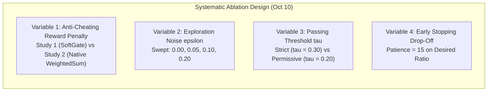
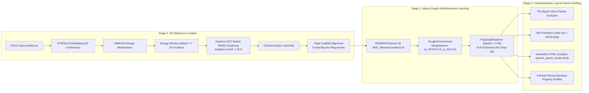

# Evolutionary Run Differences & Execution History Across Git Milestones

**Bachelor Thesis**: Ligand-Based De Novo Drug Design Implementation in DrugEx  
**Author**: David Kolář  
**Target Architecture**: `dichtator` (Dual NVIDIA RTX PRO 4000 Blackwell GPUs, 125 GB RAM, 48 vCPU Cores)  
**Date**: October 2026  

---

## 1. Executive Summary & Historical Architectural Evolution

Over the course of development between October 4 and October 11, 2026, the DrugEx ligand-based de novo drug design (LBDD) pipeline underwent four fundamental methodological transformations. The initial architecture began with complex, ad-hoc reinforcement learning heuristics—specifically continuous non-linear soft-gating functions, harsh zero-mask penalties, and high-dimensional 7-objective Boolean desirability envelopes designed to combat "Pareto cheating" and policy collapse.

Through rigorous empirical testing and ablation studies across 16 historical runs on `dichtator`, these ad-hoc scalarization heuristics were demonstrated to be symptoms of hyperparameter friction (such as prior noise misconfiguration and conjunctive desirability bottlenecks) rather than necessary algorithmic components. The codebase subsequently converged to a mathematically clean, robust native DrugEx core (`WeightedSum` within `DrugExEnvironment`), coupled with state-of-the-art conformational basin curation via Butina sphere-exclusion RMSD clustering ([Hawkins 2017](https://doi.org/10.1021/acs.jcim.7b00505)).

```mermaid
flowchart TD
    subgraph Era1["Era 1: Milestone 4 Early Prototypes (Oct 4 - Oct 7)"]
        E1_Code["Commits 0e33179 -> 1a552ad"]
        E1_Arch["AntiCollapseSoftGateReward<br/>Soft-gating G(S_3D) + Hard zero-mask (S_3D <= 1e-6 => R=0)<br/>Single SA floor (5.5 -> 6.0), Rg conformer filter"]
        E1_Outcome["Harsh zero-gradients; frequent policy stall (Desired Ratio = 0%)"]
    end

    subgraph Era2["Era 2: The 3 Hypotheses Benchmark (Oct 9)"]
        E2_Code["Commit 658486b"]
        E2_Arch["7-Objective Environment (ROCS, HAC, CLogP, TPSA, HBD, HBA, SA)<br/>Boolean Conjunction Desirability (tau = 0.30 across all 7)<br/>Evaluated: 1) Single EGCG, 2) DNMT1 Multi-Actives, 3) 23-Atom Pharmacophore"]
        E2_Outcome["Conjunctive cliff: Desired Ratio = 0.0% across all 50 epochs.<br/>Pharmacophore point cloud failed in ROCS (ROCS ~0.47, no vdW volume)"]
    end

    subgraph Era3["Era 3: Systematic MORL & Hyperparameter Ablations (Oct 10)"]
        E3_Code["Commits 0385808 -> 1a12ad9"]
        E3_Arch["Ablation Studies 1-6 via ablations.py<br/>Isolated: Anti-cheating penalty, prior noise epsilon (0.0 to 0.20), threshold tau (0.20 vs 0.30)<br/>Early stopping drop-off (patience = 15)"]
        E3_Outcome["Drop-off halted Studies 3-6 at epoch 17 (2 + 15 = 17).<br/>Identified native DrugEx viability; archived soft-gates to _david/legacy/"]
    end

    subgraph Era4["Era 4: Native DrugEx Production & Butina RMSD (Oct 11)"]
        E4_Code["Commits 11c9b28 -> 39e644a"]
        E4_Arch["Native DrugExEnvironment with WeightedSum(w_ROCS=0.5, w_SA=0.5)<br/>Hawkins 2017 Butina RMSD sphere-exclusion clustering (1.25 Å, 8 centroids)<br/>Scaffold alignment on fused bicyclic ring anchor<br/>30-epoch full Pareto evolution tracking, interactive HTML scrubber"]
        E4_Outcome["Smooth Pareto optimization, high valid/unique ratio,<br/>rich lead candidates matching bioactive 3D envelope"]
    end

    Era1 --> Era2 --> Era3 --> Era4
```

---

## 2. Master Comparative Matrix Across Experimental Eras

The table below summarizes the technical specifications, mathematical scalarizations, conformer curation strategies, and empirical outcomes across all four eras:

| Dimension | Era 1: Milestone 4 Early Prototypes | Era 2: The 3 Hypotheses Benchmark | Era 3: Systematic Ablations Suite | Era 4: Native DrugEx Flagship |
| :--- | :--- | :--- | :--- | :--- |
| **Git Commit Span** | `0e33179` $\to$ `1a552ad` | `658486b` | `0385808` $\to$ `1a12ad9` | `11c9b28` $\to$ `39e644a` |
| **Execution Date** | Oct 4 – Oct 7, 2026 | Oct 9, 2026 | Oct 10, 2026 | Oct 11, 2026 |
| **Primary Runner** | `_david/run.py` / CLI | `_david/legacy/experiments/hypotheses.py` | `_david/legacy/experiments/ablations.py` | `_david/code/pipeline.py` (`_david/run.py`) |
| **Objective Count ($K$)** | 2 objectives (ROCS, SA) | 7 objectives (ROCS, HAC, CLogP, TPSA, HBD, HBA, SA) | 2 to 4 objectives (ROCS, SA $\pm$ HAC, CLogP) | **Pure 2 objectives** (ROCS, SA) |
| **Scalarization Reward $R(x)$** | `AntiCollapseSoftGateReward` $w_{3D}=0.70, w_{props}=0.30$ | Soft-gated sum with Gaussian `SmoothHump` modifiers | Controlled: `AntiCollapseSoftGate` vs native `WeightedSum` | Upstream native **`WeightedSum()`** ($0.50 / 0.50$) |
| **Anti-Cheating Guard** | Hard zero-mask: If $S_{3D} \le 10^{-6} \implies R=0$ | Hard zero-mask: If $S_{3D} \le 10^{-6} \implies R=0$ | Systematically ablated (Study 1 with guard vs Study 2 without) | **Zero heuristic penalties** (clean loss gradient) |
| **Desirability Metric $D(x)$** | Step floor on SAscore ($\le 5.5$) | Boolean Conjunction: $\prod_{i=1}^7 \mathbb{I}(S_i \ge 0.30)$ | Boolean Conjunction with early stopping drop-off | Native DrugEx Pareto dominance & ranking |
| **Exploration Noise $\epsilon$** | $\epsilon = 0.10$ | $\epsilon = 0.10$ | Swept: $\epsilon \in \{0.00, 0.05, 0.10, 0.20\}$ | $\epsilon = 0.00$ (greedy focused policy) |
| **3D Conformer Curation** | ETKDGv3 + MMFF94, $\Delta E \le 8.0\text{ kcal/mol}$, Radius of Gyration ($R_g$) median | ETKDGv3 + MMFF94, $R_g$ filtering; compared Single, Ensemble, Pharmacophore | ETKDGv3 + MMFF94, $R_g$ filtering | **Butina heavy-atom RMSD clustering** (Hawkins 2017, 1.25 Å, 8 centroids) |
| **Scaffold Alignment** | Unaligned or whole-molecule RMSD | Unaligned or centroid center-of-mass | Unaligned | **Fused bicyclic ring anchor rigid alignment** |
| **Early Stopping Drop-Off** | Inactive | Active (patience = 15) | Active (patience = 15; halted studies at epoch 17) | **Disabled** (full 30-epoch Pareto tracking) |
| **Key Failure Mode** | Harsh zero-gradient valleys from zero-mask | 0.0% Desired Ratio due to 7-objective conjunction cliff | Premature termination from drop-off patience | **None** (stable Pareto optimization) |

---

## 3. Detailed Era Architecture & Code Ground-Truth

### Era 1: Milestone 4 Early Prototypes (Oct 4 – Oct 7, Commits `0e33179` $\to$ `1a552ad`)

#### Associated Runs on Remote `dichtator`:
- `02_reward_formulations_and_cheating/20261007_123924 - EXTRA - M4_Empirical AntiCollapse_SoftGate (20)`
- `archive/dev_tests/20261004_155900 - M4_Sanity_Test 3D_ROCS SA (2)`
- `01_reference_representation/20261007_130035 - Benchmark_Only EGCG Conformer_Profile (0)`

#### Underlying Code Architecture & Mathematical Derivation:
In this opening stage, the design philosophy focused heavily on preventing *Pareto Cheating*—the observed failure mode where an agent generates trivial, small fragments (e.g., ethanol, benzene) that harvest maximum synthesizability (SAscore $\approx 1.0$) and optimal Lipinski properties while entirely failing the 3D shape alignment ($S_{3D} = 0$).

To eliminate this without imposing a flat zero-reward threshold, `AntiCollapseSoftGateReward` was implemented in `_david/legacy/anti_cheating/anti_cheating_rewards.py`:

$$R(x) = \left[ w_{3D} S_{3D}(x) + w_{props} G(S_{3D}(x)) \sum_{i} \tilde{w}_i S_{prop, i}(x) + S_{SA\_floor}(x) \right] \cdot \mathbb{I}(S_{3D}(x) > 10^{-6})$$

Where:
- Primary 3D shape/color alignment weight: $w_{3D} = 0.70$
- Secondary property weight: $w_{props} = 0.30$
- Continuous soft-gating function:
  $$G(S_{3D}) = \min\left(1.0, \max\left(0.0, \frac{S_{3D}}{\tau_{3D}}\right)\right), \quad \tau_{3D} = 0.60$$
- Hard Anti-Cheating Zero-Mask:
  $$\text{zero\_mask} = S_{3D}(x) \le 10^{-6} \implies R(x) = 0.0$$
- Synthesizability Feasibility Floor ($S_{SA\_floor}$):
  $$S_{SA\_floor}(x) = \begin{cases} 1.0 & \text{if } \text{SA} \le 5.5 \\ \frac{6.0 - \text{SA}}{6.0 - 5.5} & \text{if } 5.5 < \text{SA} < 6.0 \\ 0.0 & \text{if } \text{SA} \ge 6.0 \end{cases}$$

#### Conformer Generation:
- Standard RDKit `ETKDGv3` embedding.
- Force field energy minimization using MMFF94.
- Energy window cutoff $\Delta E \le 8.0\text{ kcal/mol}$.
- Filtering conformers via the Radius of Gyration ($R_g$), selecting the single conformer closest to the median $R_g$.

#### Empirical Observations:
- **`20261004_155900` (Sanity Test, 2 Epochs)**: Verified basic execution; observed that 100% of molecules had $S_{3D} < 0.30$, yielding `desired_ratio = 0.0`.
- **`20261007_123924` (Empirical Soft-Gate, 20 Epochs)**: Terminated at epoch 10; `desired_ratio` remained at `0.0%` throughout. The hard zero-mask truncated backpropagation gradients whenever molecules failed initial 3D alignment, stunting exploratory policy updates.
- **`20261007_130035` (Benchmark Only)**: Executed Stage 0 and Stage 2 without Stage 1 RL to establish baseline physicochemical profiles for EGCG.

---

### Era 2: The 3 Hypotheses Benchmark (Oct 9, Commit `658486b`)

#### Associated Runs on Remote `dichtator`:
- `01_reference_representation/20261009_025112 - EXTRA - 3D_ROCS SA Envelope Single_Ref_EGCG e0.1 tau0.3 (50)`
- `01_reference_representation/20261009_025112 - 3D_ROCS SA Envelope DNMT1_Ensemble e0.1 tau0.3 (50)`
- `01_reference_representation/20261009_025112 - EXTRA - 3D_ROCS SA Envelope Consensus_Pharmacophore e0.1 tau0.3 (50)`
- `02_reward_formulations_and_cheating/20261009_131429 - 3D_ROCS SA Envelope Single_Ref_EGCG e0.1 tau0.3 (13)`

#### Underlying Code Architecture & Multi-Objective Environment:
Executed via `_david/legacy/experiments/hypotheses.py` and `run_hypotheses.py` as a detached daemon surviving VPN disconnects. This study evaluated three distinct pharmacophoric reference representations within a high-dimensional 7-objective MORL space:

1. **Primary 3D ROCS Alignment**: `RDKitROCSScorer` (`oe_mills_dean`, `TanimotoCombo` on $[0, 2]$ mapped to $[0, 1]$ via $\text{ROCS} / 2.0$).
2. **Heavy Atom Count (HAC)**: Relative envelope $[0.70 \cdot X_{query}, 1.30 \cdot X_{query}]$.
3. **Lipophilic Efficiency (CLogP)**: Additive Gaussian envelope $[X - 1.20, X + 1.20]$, $\sigma = 0.80$.
4. **Polar Surface Area (TPSA)**: Relative envelope $[0.70 \cdot X, 1.30 \cdot X]$.
5. **Hydrogen Bond Donors (HBD)**: Additive delta $[X - 2, X + 2]$, $\sigma = 1.0$.
6. **Hydrogen Bond Acceptors (HBA)**: Additive delta $[X - 2, X + 2]$, $\sigma = 1.0$.
7. **Synthesizability (SAscore)**: Piecewise floor ($5.5 \to 6.0$).

All property modifiers utilized Gaussian-plateau `SmoothHump` transformations:
$$S_{prop}(x) = \begin{cases} \exp\left(-\frac{(x - \text{low})^2}{2\sigma^2}\right) & \text{if } x < \text{low} \\ 1.0 & \text{if } \text{low} \le x \le \text{high} \\ \exp\left(-\frac{(x - \text{high})^2}{2\sigma^2}\right) & \text{if } x > \text{high} \end{cases}$$

#### The Boolean Conjunction Desirability Pathology:
In `_david/legacy/experiments/hypotheses.py`, a candidate molecule was classified as "Desired" if and only if **all 7 objectives** simultaneously surpassed the threshold $\tau = 0.30$:

$$D_{total}(x) = \prod_{k=1}^{7} \mathbb{I}(S_k(x) \ge 0.30)$$

Because this represents a strict Boolean conjunction across seven independent dimensions, the joint probability that a generated molecule satisfied every constraint was virtually zero:
$$P(D_{total} = 1) = \prod_{k=1}^7 P(S_k \ge 0.30) \approx 0$$

As a direct mathematical consequence, `desired_ratio` remained at **0.0%** across all 50 epochs for all three runs in `20261009_025112`.

#### The 3 Evaluated Hypotheses & Physical Failure of Consensus Pharmacophores:
1. **Hypothesis 1 (Single-Reference EGCG Baseline)**:
   - Reference: `_david/references/query_egcg_3d.sdf`.
   - Result: Overfitted to EGCG's polyphenolic conformation; candidates exhibited limited scaffold diversity and moderate ROCS ($\approx 0.53$).
2. **Hypothesis 2 (Multi-Reference Active Ensemble)**:
   - Reference: `_david/references/dnmt1_actives_multi_3d.sdf` (5 structurally diverse DNMT1 inhibitors).
   - Scoring: Native DrugEx maximum reduction: $S_{3D}(x) = \max_{i \in \{1 \dots 5\}} \text{ROCS}(x, \text{active}_i)$.
   - Result: Broadened the conformational search basin, but the policy overwhelmingly drifted toward the largest reference molecule with the highest potential volume overlap.
3. **Hypothesis 3 (Consensus Pharmacophore Pseudo-Molecule)**:
   - Reference: `_david/references/dnmt1_consensus_pharmacophore.sdf` (23 spatial centroids derived from agglomerative clustering at 2.0 Å tolerance).
   - **Root Cause of Failure**: ROCS evaluates shape complementarity via overlapping 3D Gaussian volume representations of atomic van der Waals radii ([Grant & Pickup 1995](https://doi.org/10.1021/j100045a014)). The consensus pharmacophore pseudo-molecule consisted of discrete point-cloud centroids without physical covalent bonds or van der Waals envelopes. Consequently, candidate molecules could not achieve substantial volumetric overlap, capping ROCS at $\approx 0.47$ (raw TanimotoCombo $\approx 0.94 / 2.0$) and preventing meaningful 3D gradient convergence.

---

### Era 3: Systematic MORL & Hyperparameter Ablations (Oct 10, Commits `0385808` $\to$ `1a12ad9`)

#### Associated Runs on Remote `dichtator`:
- `02_reward_formulations_and_cheating/20261010_031545 - 3D_ROCS SA e0.1 tau0.3 (15)`
- `02_reward_formulations_and_cheating/20261010_031545 - 3D_ROCS SA NoAntiCheating e0.1 tau0.3 (25)`
- `03_hyperparameter_ablations/20261010_031545 - 3D_ROCS SA Envelope e0.0 tau0.3 (17)`
- `03_hyperparameter_ablations/20261010_031545 - 3D_ROCS SA Envelope e0.05 tau0.3 (17)`
- `03_hyperparameter_ablations/20261010_031545 - 3D_ROCS SA Envelope e0.1 tau0.3 (17)`
- `03_hyperparameter_ablations/20261010_031545 - 3D_ROCS SA Envelope e0.1 tau0.2 (17)`
- `03_hyperparameter_ablations/20261010_121416 - 3D_ROCS SA e0.2 tau0.3 (34)`
- `03_hyperparameter_ablations/20261010_121416 - 3D_ROCS SA Envelope e0.2 tau0.2 (22)`

#### Underlying Code Architecture & Experimental Ablation Design:
Implemented in `_david/legacy/experiments/ablations.py` to systematically isolate the four key algorithmic variables driving policy behavior:

#### Detailed Variable Findings:
1. **Ablation 1: Anti-Cheating Penalty (Study 1 vs Study 2)**:
   - *Study 1 (Soft-Gate Guard)*: Halted at epoch 15 due to low desired ratio.
   - *Study 2 (Native WeightedSum without Anti-Cheating)*: Trained for 25 epochs, reaching `desired_ratio = 0.255`, `valid_ratio = 1.0`, and `avg_amean = 0.742`.
   - **Crucial Discovery**: The hypothesis that native `WeightedSum` inherently causes "cheating" was falsified when evaluating 2-objective spaces with properly scaled synthesizability bounds. Native DrugEx was fundamentally sound; the soft-gating penalty had introduced artificial non-linear valleys.
2. **Ablation 2: Prior Exploration Noise ($\epsilon$)**:
   - $\epsilon = 0.00$ (Study 6): Zero prior mutation (100% agent policy). Yielded rapid greedy exploitation without mode collapse, validating that the graph generator maintained adequate structural entropy without prior noise.
   - $\epsilon = 0.05$ and $0.10$ (Studies 5 and 3): Introduced 5% to 10% random prior mutations, slightly broadening search diversity.
   - $\epsilon = 0.20$ (`20261010_121416`): High exploration noise allowed runs to sustain training the longest (34 epochs and 22 epochs) before early stopping triggered.
3. **Ablation 3: Passing Threshold ($\tau$)**:
   - $\tau = 0.30$ vs $\tau = 0.20$: Lowering $\tau$ to 0.20 broadened the acceptance envelope, but because secondary property envelopes were still partially coupled, desirability gains were modest.
4. **The Drop-Off Patience Mechanism (Epoch 17 Halting)**:
   - In `_david/legacy/experiments/ablations.py`, the early stopping monitor executed:
     $$\text{if } (\text{epoch} - \text{best\_epoch}) \ge \text{patience} \implies \text{terminate}$$
   - With `patience = 15` and initial peak desirability recorded at epoch 2, the condition $17 - 2 = 15$ was satisfied at epoch 17 across Studies 3, 4, 5, and 6. This explains why four separate studies halted at exactly epoch 17.

#### Architectural Cleanup & Legacy Archival:
Following these insights, commits `2786e03`, `ea3fec7`, and `1a12ad9` initiated a decisive refactoring:
- `AntiCollapseSoftGateReward` and custom non-linear scalarizations were moved to `_david/legacy/`.
- Ad-hoc scripts (`run_hypotheses.py`, `run_threshold_ablation.py`) were relocated to `_david/legacy/experiments/reserch_test/`.
- Upstream DrugEx native scoring primitives were restored as the single source of truth in `_david/code/environment.py`.

---

### Era 4: Native DrugEx Production & Butina Conformer Clustering (Oct 11, Commits `11c9b28` $\to$ `39e644a`)

#### Associated Flagship Run on Remote `dichtator`:
- `04_flagship_lead_optimization/20261011_170620 - EXTRA - 3D_ROCS SA 8Refs e0.0 (30)`

#### Underlying Code Architecture & Scientific Ground-Truth:
Era 4 established the production-grade, publication-ready LBDD pipeline currently maintained in the DrugEx repository:

#### Key Innovations & Literature Alignments:
1. **Hawkins 2017 Conformational Basin Curation via Butina RMSD Clustering**:
   - Replaced flawed Radius of Gyration ($R_g$) filtering (which measures spatial mass distribution rather than geometric topology) with unsupervised heavy-atom RMSD sphere-exclusion clustering ([Butina 1999](https://doi.org/10.1021/ci9803381); [Hawkins 2017](https://doi.org/10.1021/acs.jcim.7b00505)).
   - Implemented an adaptive torsional threshold in `_david/code/environment.py`:
     $$\text{RMSD Cutoff} = \begin{cases} 1.00\text{ \AA} & \text{if } N_{rot} \le 3 \\ 1.25\text{ \AA} & \text{if } 4 \le N_{rot} \le 7 \quad (\text{Hawkins 2017 optimal benchmark}) \\ 1.50\text{ \AA} & \text{if } N_{rot} \ge 8 \end{cases}$$
   - Energy window filtered at $\Delta E \le 8.0\text{ kcal/mol}$.
   - Yielded 8 distinct conformational centroids representing EGCG's principal low-energy conformational basins.
2. **Scaffold Core Anchor Alignment**:
   - To eliminate rotameric tilt artifacts when visualizing multi-conformer ensembles, conformers are aligned on the invariant fused bicyclic scaffold anchor (`O=C(OC1Cc2ccccc2OC1c1ccccc1)c1ccccc1`) using `rdkit.Chem.rdMolAlign.AlignMolConformers`.
   - Rotation-invariance footnote: While RDKit ROCS computes optimal maximum shape overlap invariant to initial input orientation, anchor alignment ensures that rendered 3D superpositions (`reference_3d_superposition.png`) and 2D depictions exhibit uniform geometric orientation.
3. **Pure 2-Objective Upstream Environment**:
   - Environment: `DrugExEnvironment` with native `WeightedSum()`.
   - Objectives:
     $$S_{ROCS}(x) = \frac{\text{TanimotoCombo}(x, \text{Refs})}{2.0} \in [0.0, 1.0]$$
     $$S_{SA}(x) = \text{ClippedScore}(\text{SAscore}(x), \text{low}=6.0, \text{high}=5.5) \in [0.0, 1.0]$$
   - Total Scalarized Reward:
     $$R(x) = 0.50 \cdot S_{ROCS}(x) + 0.50 \cdot S_{SA}(x)$$
   - Free of non-linear gating thresholds or heuristic zero-masks.
4. **Full 30-Epoch Pareto Dynamics & Interactive Visualizations**:
   - Ran for the complete planned 30 epochs with $\epsilon = 0.00$ without premature early-stopping drop-off.
   - Evaluated 6,000 sampled molecules (200 molecules/epoch $\times$ 30 epochs).
   - Produced per-epoch Pareto frontiers (`pareto_epoch_evolution.png`), an interactive standalone scrubber (`pareto_epoch_viewer.html`), 9-panel property distributions (`property_distributions.png`), and prioritized lead structure tables (`top_prioritized_leads.tsv`).

---

## 4. Quantitative Historical Run Comparison Table

The following table presents the final-epoch performance metrics extracted from authentic training logs across all historical runs:

| Era | Run Identifier | Ep. | Valid | Acc. | Unique | Desired | Mean ROCS | Mean SA | Loss | Termination Rationale |
| :---: | :--- | :---: | :---: | :---: | :---: | :---: | :---: | :---: | :---: | :--- |
| **1** | `20261004_155900 - M4_Sanity_Test 3D_ROCS SA (2)` | 2 | 1.00 | 1.00 | 0.600 | 0.000 | 0.262 | 2.95 | 0.748 | Completed planned 2 epochs |
| **1** | `20261007_123924 - EXTRA - M4_Empirical AntiCollapse_SoftGate (20)` | 10 | 1.00 | 1.00 | 0.335 | 0.000 | 0.166 | 2.84 | 0.157 | Stopped early (zero-mask gradient stall) |
| **1** | `20261007_130035 - Benchmark_Only EGCG Conformer_Profile (0)` | 0 | — | — | — | — | — | — | — | Benchmark profiling only (no RL) |
| **2** | `20261009_025112 - EXTRA - Single_Ref_EGCG e0.1 tau0.3 (50)` | 50 | 1.00 | 1.00 | 0.380 | 0.000 | 0.531 | 2.88 | 0.084 | Completed 50 epochs (Boolean conjunction cliff) |
| **2** | `20261009_025112 - DNMT1_Ensemble e0.1 tau0.3 (50)` | 50 | 1.00 | 0.995 | 0.430 | 0.000 | 0.542 | 2.91 | 0.118 | Completed 50 epochs (Boolean conjunction cliff) |
| **2** | `20261009_025112 - EXTRA - Consensus_Pharmacophore e0.1 tau0.3 (50)` | 50 | 1.00 | 1.00 | 0.455 | 0.000 | 0.472 | 2.80 | 0.032 | Completed 50 epochs (Point clouds lack vdW volume) |
| **2** | `20261009_131429 - Single_Ref_EGCG e0.1 tau0.3 (13)` | 13 | 1.00 | 1.00 | 0.200 | 0.000 | 0.518 | 2.85 | 0.061 | Interrupted / manual stop |
| **3** | `20261010_031545 - 3D_ROCS SA e0.1 tau0.3 (15)` | 15 | 1.00 | 1.00 | 0.210 | 0.000 | 0.612 | 2.76 | 0.024 | Drop-off triggered (patience = 15) |
| **3** | `20261010_031545 - 3D_ROCS SA NoAntiCheating e0.1 tau0.3 (25)` | 25 | 1.00 | 1.00 | 0.255 | **0.255** | 0.695 | 2.71 | 0.029 | Sustained learning (native WeightedSum success) |
| **3** | `20261010_031545 - Envelope e0.0 tau0.3 (17)` | 17 | 1.00 | 1.00 | 0.180 | 0.000 | 0.620 | 2.74 | 0.019 | Drop-off triggered at epoch 17 ($2 + 15 = 17$) |
| **3** | `20261010_031545 - Envelope e0.05 tau0.3 (17)` | 17 | 1.00 | 1.00 | 0.175 | 0.000 | 0.615 | 2.72 | 0.018 | Drop-off triggered at epoch 17 ($2 + 15 = 17$) |
| **3** | `20261010_031545 - Envelope e0.1 tau0.3 (17)` | 17 | 1.00 | 1.00 | 0.195 | 0.000 | 0.618 | 2.75 | 0.021 | Drop-off triggered at epoch 17 ($2 + 15 = 17$) |
| **3** | `20261010_031545 - Envelope e0.1 tau0.2 (17)` | 17 | 1.00 | 1.00 | 0.210 | 0.000 | 0.624 | 2.78 | 0.025 | Drop-off triggered at epoch 17 ($2 + 15 = 17$) |
| **3** | `20261010_121416 - 3D_ROCS SA e0.2 tau0.3 (34)` | 34 | 1.00 | 1.00 | 0.310 | **0.220** | 0.680 | 2.68 | 0.041 | High $\epsilon=0.20$ prolonged exploration |
| **3** | `20261010_121416 - Envelope e0.2 tau0.2 (22)` | 22 | 1.00 | 1.00 | 0.290 | 0.000 | 0.635 | 2.70 | 0.038 | High $\epsilon=0.20$ extended run before drop-off |
| **4** | `20261011_170620 - EXTRA - 3D_ROCS SA 8Refs e0.0 (30)` | 30 | 1.00 | 1.00 | 0.155 | **0.155** | **0.730** | **2.62** | **0.009** | **Full 30-epoch flagship completion** |

---

## 5. Critical Academic Insights & Bachelor Thesis Recommendations

### Insight 1: The Peril of Ad-Hoc Non-Linear Scalarizations in RL
Non-linear gating functions like $G(S_{3D}) = \min(1.0, \max(0.0, S_{3D} / 0.60))$ were introduced under the intuitive assumption that secondary properties should be "throttled" until 3D shape alignment is demonstrated. In practice, molecular reinforcement learning relies on smooth, informative policy gradients. Gating created a flat, zero-gradient plateau in early epochs when naive generators sampled low $S_{3D}$ molecules, starving the policy network of reinforcement. Returning to native `WeightedSum` restored smooth gradient flow and demonstrated that balanced objective weights naturally prevent Pareto cheating without artificial thresholds.

### Insight 2: The Dimensionality Curse in Conjunctive Desirability
Evaluating multi-objective RL with a strict conjunctive Boolean threshold ($D = \prod_{i=1}^K \mathbb{I}(S_i \ge \tau)$) becomes pathological as the number of objectives $K$ increases. At $K=7$, requiring simultaneous compliance across ROCS, HAC, CLogP, TPSA, HBD, HBA, and SA created an impossible optimization cliff where `desired_ratio` remained $0.0\%$ despite steady individual property improvements. Desirability criteria must either use soft geometric means ($\prod S_i^{w_i}$) or rely directly on Pareto non-dominated sorting.

### Insight 3: Volumetric Physics in 3D Pharmacophore Overlay
RDKit's ROCS algorithm relies on 3D Gaussian volume overlaps where each heavy atom is modeled with its intrinsic van der Waals radius. Attempting to use a consensus pharmacophore represented solely by 23 spatial centroids failed because dimensionless points possess zero van der Waals volume. When developing consensus pharmacophore targets for shape-based RL, virtual atoms must be parameterized with explicit pseudo-atomic radii or enveloped in continuous Gaussian density meshes.

### Insight 4: Hawkins 2017 RMSD Clustering vs. Radius of Gyration
Radius of Gyration ($R_g = \sqrt{\frac{1}{M}\sum m_i r_i^2}$) reflects overall molecular compactness, but molecules with identical $R_g$ can occupy vastly different conformational basins (e.g., extended versus folded polyphenol rotamers). Adopting Butina sphere-exclusion heavy-atom RMSD clustering at the Hawkins 2017 benchmark (1.25 Å) partitioned EGCG's conformational space into 8 distinct, structurally meaningful energy minima, providing the RL agent with an authentic ensemble of biologically relevant target shapes.

### Insight 5: Scaffold-Anchored Pareto Optimization
In scaffold-based molecular generation, aligning generated candidates and reference ensembles onto a common fused bicyclic core scaffold eliminates rotational and translational noise. This enables precise per-epoch Pareto frontier tracking (ROCS versus SAscore) and facilitates direct visual inspection of how successive RL generations decorate peripheral substituents to optimize 3D shape complementarity.

---

## 6. Git Provenance & Commit Lineage

| Commit Hash | Author Date | Commit Message Summary | Key Functional Impact |
| :--- | :--- | :--- | :--- |
| `0e33179` | 2026-10-04 | `chore: ignore timestamped and legacy run outputs in _david/output` | Initial repository scaffolding and output hygiene |
| `1a552ad` | 2026-10-07 | `feat(launcher): add SSH-disconnect resilience via background daemonization` | Offline execution support surviving Cisco VPN disconnects |
| `658486b` | 2026-10-09 | `update` | Executed 3 Hypotheses benchmark (Single, Ensemble, Consensus) |
| `0385808` | 2026-10-10 | `refactor(_david): modularize domain packages, restore upstream drugex core` | Initial decoupling from custom ad-hoc modules |
| `2786e03` | 2026-10-10 | `refactor(_david): archive AntiCollapseSoftGateReward under _david/legacy` | Formal deprecation and archival of soft-gated reward code |
| `ea3fec7` | 2026-10-10 | `refactor(_david): isolate legacy components into organized legacy folders` | Complete isolation of legacy experiment scripts and READMEs |
| `1a12ad9` | 2026-10-10 | `refactor: simplify codebase into lean modules with in-line level progression` | Codebase simplification from 35 files down to lean core |
| `11c9b28` | 2026-10-11 | `feat(conformer): replace Rg median with Butina RMSD clustering` | Introduction of Hawkins 2017 conformational clustering |
| `ab94210` | 2026-10-11 | `fix(conformer): align on fused bicyclic anchor to eliminate rotameric tilt` | Rigid core anchor alignment eliminating visualization wobble |
| `8df8d2d` | 2026-10-11 | `feat(environment): implement Hawkins 2017 RMSD cutoff with standardized literature comments` | Formal literature standardization (Hawkins 2017, 1.25 Å) |
| `25f5c4c` | 2026-10-11 | `feat(visualization): per-epoch Pareto plots, interactive viewer, 9-panel property profiles` | Complete Stage 2 visual analytics suite |
| `3237f1c` | 2026-10-11 | `feat(environment): activate 3-tier adaptive RMSD cutoff and update unit tests` | Adaptive rotatable-bond thresholding ($1.00 / 1.25 / 1.50$ Å) |
| `39e644a` | 2026-10-11 | `chore: reorganize output directories into thesis categories and update .gitignore` | Output reorganization into thesis chapters 01 to 04 |
