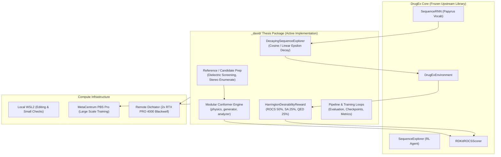

# 00: Project Architecture & System Overview

> **Author**: Antigravity (Gemini 3.8 Flash High)  
> **Prepared for**: Gemini 4.0 Argon & David Kolár  
> **Date**: 2026-10-29  
> **Scope**: Structural reference, architectural boundaries, and operational map for the Bachelor's Thesis: *RNN Ligand-Based De Novo Drug Design in DrugEx*.

---

## 1. Executive Summary & Research Objective

The goal of this bachelor's thesis is the **de novo design of bioactive small molecules** targeting **DNMT1** (DNA Methyltransferase 1) using **(-)-Epigallocatechin gallate (EGCG)** as the primary active 3D shape reference, driven by:
1. **Unprompted SequenceRNN Generator**: An autoregressive recurrent neural network trained on Papyrus SMILES strings.
2. **3D ROCS Shape & Chemical Feature (Color) Scoring**: Evaluating generated candidate poses against reference 3D conformers via OpenEye-style Gaussian overlays implemented in RDKit (`RDKitROCSScorer`).
3. **Multi-Objective Reinforcement Learning**: Combining shape/color similarity (ROCS), drug-likeness (QED), and synthetic accessibility (SA) via continuous **Harrington Desirability functions** (`HarringtonDesirabilityReward`) with decaying exploration noise (`DecayingSequenceExplorer`).



---

## 2. Structural Repository Layout

The workspace strictly enforces a clean separation of concerns. **DrugEx core remains read-only**; all thesis-specific algorithms, wrappers, benchmarks, and outputs reside exclusively under `_david/`.

```
/home/kolar/DrugEx/
├── drugex/                    # FROZEN UPSTREAM LIBRARY (Read-Only)
│   ├── data/                  # Corpus, dataset suppliers, SMILES vocabularies
│   ├── molecules/             # Standardizers, fragmenters, molecular converters
│   ├── parallel/              # Multiprocessing evaluators and collectors
│   └── training/              # Reinforcement learning, generators, scorers, rewards
│       ├── generators/        # SequenceRNN, SequenceTransformer, GraphTransformer (abandoned)
│       ├── explorers/         # SequenceExplorer, FragSequenceExplorer
│       ├── scorers/           # RDKitROCSScorer, SAScorer, Property (QED), interfaces
│       └── rewards/           # WeightedSum, ParetoCrowdingDistance
│
├── _david/                    # ACTIVE THESIS IMPLEMENTATION
│   ├── AGENTS.md              # Authoritative project instructions & working agreement
│   ├── in_molecule.txt        # Input SMILES query (default: EGCG)
│   ├── code/                  # Main Python source package
│   │   ├── chemistry.py       # Double-precision pickling, disjoint seeds, ETKDGv3 & MMFF94s/UFF
│   │   ├── config.py          # Paths, model checkpoints, environment & reference selection settings
│   │   ├── conformer/         # Consolidated 12-module conformer calibration & benchmarking suite
│   │   │   ├── __init__.py            # Public exports for sampling, reference banks, and utilities
│   │   │   ├── calibrate.py           # Joint conformer-budget & Butina RMSD calibration runner
│   │   │   ├── diagnostics.py         # Single-query 3D geometry & force-field diagnostics
│   │   │   ├── drug_panel.py          # Curated 512-molecule ChEMBL drug panel builder
│   │   │   ├── mega.py                # Multi-molecule parallel self-recovery & timing study
│   │   │   ├── reference_bank.py      # R50/I8 disjoint-stream reference bank builder
│   │   │   ├── results.md             # Chronological scientific log & calibration ledger
│   │   │   ├── reward_calibration.py  # Unified 144-cell grid calibration, replay & query planner
│   │   │   ├── rl_cost_probe.py       # Empirical per-epoch RL scoring latency profiler
│   │   │   ├── sampling.py            # Complexity-aware conformer & isomer budget planner
│   │   │   ├── self_recovery.py       # Single-query self-recovery curve evaluator
│   │   │   ├── utils.py               # Shared SDF I/O, atomic JSON, SHA-256 & job collection
│   │   │   └── visualization.py       # Publication plots for recovery, heatmaps, Pareto & RL cost
│   │   ├── environment.py     # ROCS scorer factory & Harrington desirability reward
│   │   ├── models.py          # DecayingSequenceExplorer & agent/prior loaders
│   │   ├── pipeline.py        # RL training loop, epoch monitoring & evaluation
│   │   ├── reference.py       # 3D reference preparation, Butina RMSD & diverse_order selection
│   │   ├── rocs.py            # ROCS Gaussian overlay bindings & WholeCallScorer worker pool
│   │   ├── schema.py          # Data schemas and standard score column keys
│   │   ├── utils.py           # HardwareManager, GPU allocation & logging
│   │   └── visualization.py   # Publication-grade diagnostics and distribution plots
│   │
│   ├── output/                # RUN ARTIFACTS, EXPERIMENTAL DATA & SCORECARDS
│   │   ├── run16_sequencer_weighted_sum/     # 50-epoch RL with WeightedSum reward
│   │   ├── run17_baseline_50ep/              # 50-epoch baseline RL run
│   │   ├── run18_epsilon_zero_50ep/          # 50-epoch pure REINFORCE run (ε = 0)
│   │   ├── 20261028_2145_joint_calibration/  # Full 512-drug panel calibration
│   │   ├── 20261029_0250_reward_calibration/ # Superseded (RDKit seed multiplication bug)
│   │   ├── 20261029_1155_reward_calibration/ # Corrected independent-stream calibration
│   │   └── ...                               # (Detailed in 03_OUTPUTS_AND_EXPERIMENTS_CATALOG.md)
│   │
│   ├── reference/             # HANDOFF & ARCHITECTURAL REFERENCE (This directory)
│   │   ├── 00_PROJECT_OVERVIEW_AND_ARCHITECTURE.md  # Main executive overview
│   │   ├── 01_DRUGEX_CORE_ECOSYSTEM.md              # DrugEx upstream library details
│   │   ├── 02_CHATGPT_CODEX_AUTOPSY_AND_BRANCHES.md # The "not-good-chatGPT" post-mortem
│   │   ├── 03_OUTPUTS_AND_EXPERIMENTS_CATALOG.md    # Map of all runs & data files
│   │   └── 04_ENVIRONMENT_TOPOLOGY_AND_TOOLING.md   # WSL2, Dichtator, Grid & Skills
│   │
│   └── tests/                 # Deterministic Pytest suite (all tests passing)
│
└── .agents/skills/            # ACTIVE AGENT CAPABILITIES
    ├── drug-design-science/   # Unified cheminformatics, PDB, Mol*, dielectric physics
    ├── scientific-literature/ # Tier 1 Undermind MCP + Tier 2 unmetered literature hub
    ├── consult-literature/    # Scientific decision protocol before method changes
    └── drugex-dichtator/      # Zero-disruption SSH multiplexing to lab server
```

---

## 3. The Satellite Reference Documents Index

To keep context sharp, modular, and directly searchable, the handoff is organized into dedicated technical satellite files:

| File | Primary Focus | Key Topics Covered |
| :--- | :--- | :--- |
| **[`01_DRUGEX_CORE_ECOSYSTEM.md`](01_DRUGEX_CORE_ECOSYSTEM.md)** | DrugEx Upstream Architecture | `SequenceRNN`, Papyrus vocabulary tokenization, lack of `@`/`/`/`\` (achiral SMILES), `SequenceExplorer`, `RDKitROCSScorer`, why `GraphTransformer` was abandoned. |
| **[`02_CHATGPT_CODEX_AUTOPSY_AND_BRANCHES.md`](02_CHATGPT_CODEX_AUTOPSY_AND_BRANCHES.md)** | ChatGPT / Codex Post-Mortem | Why the user disliked ChatGPT (runaway autonomy, lack of in-the-loop validation, daemon pollution); forensic catalog of the 23 `codex/*` branches; RDKit seed multiplication bug (`42 * 43 = 1806`); parameter mutation bug. |
| **[`03_OUTPUTS_AND_EXPERIMENTS_CATALOG.md`](03_OUTPUTS_AND_EXPERIMENTS_CATALOG.md)** | Output Data & Calibration Map | Detailed analysis of RL runs (`run16`–`run18`), conformer studies, the 512-drug panel, Pareto trade-offs (throughput vs conformer budget), and data provenance. |
| **[`04_ENVIRONMENT_TOPOLOGY_AND_TOOLING.md`](04_ENVIRONMENT_TOPOLOGY_AND_TOOLING.md)** | Systems, Hardware & Tooling | Local WSL2 vs Remote Dichtator (2x RTX PRO 4000 Blackwell) vs MetaCentrum PBS Pro grid; SSH ControlMaster multiplexing; Undermind MCP configuration; `scientific-literature` two-tiered architecture. |

---

## 4. Fundamental Scientific & Algorithmic Principles

When developing or debating code with David, adhere strictly to these principles:

1. **Tight Pair-Programming Loop for Frontier Work**:
   Never embark on long, autonomous, black-box execution runs. Keep intermediate milestones small, testable, and transparent. Validate assumptions empirically with the user before committing compute.
2. **Brutally Honest Academic Persona**:
   Subject every hypothesis to rigorous critique. Automatically challenge phrases like *"I think"*, *"maybe"*, or *"what do you think?"*. Never agree blindly; state physical trade-offs and computational costs candidly.
3. **Molecule-Agnostic Design**:
   References are inputs; EGCG is the default benchmark molecule, not a hardcoded special case. Algorithms must handle diverse drug-like structures, varied rotatable bond counts, and varying stereocenter counts.
4. **Physical Dielectric Screening ($\epsilon_r = 6.5$)**:
   In vacuum ($\epsilon_r = 1.0$), polar molecules like EGCG collapse into unphysical intramolecular hydrogen-bonding traps. Using a distance-dependent or pocket dielectric constant ($\epsilon_r \approx 6.5$) flattens the energy barrier, recovering bioactive open conformations.
5. **Separation of Reference Prep ($K_{\mathrm{ref}}$) vs Candidate Scoring ($K_{\mathrm{gen}}$)**:
   - **Target Reference Preparation**: One-time cost. Generating $K_{\mathrm{ref}} = 3$ diverse low-energy conformers is sufficient.
   - **Candidate Scoring**: Repeated millions of times during RL. $K_{\mathrm{gen}} = 10$ conformers provides $>98\%$ shape recovery at $3\times$ higher throughput than $K_{\mathrm{gen}} = 30$.
