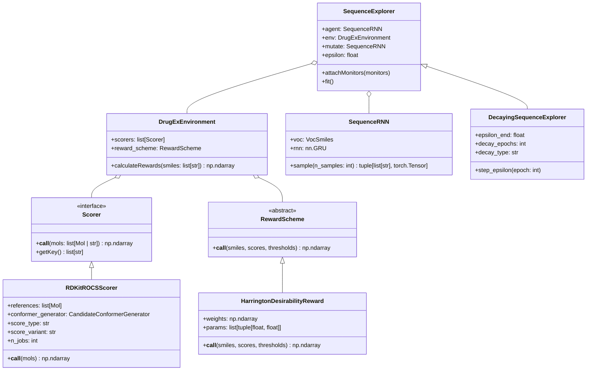

# 01: DrugEx Core Ecosystem & Algorithmic Architecture

> **Author**: Antigravity (Gemini 3.8 Flash High)  
> **Prepared for**: Gemini 4.0 Argon & David Kolár  
> **Date**: 2026-10-29  
> **Scope**: In-depth reference on DrugEx upstream libraries, sequence modeling, vocabulary constraints, and scoring interfaces.

---

## 1. Upstream Library Architecture (`drugex/`)

DrugEx (Drug Explorer) is an open-source cheminformatics and deep learning framework for de novo molecular design developed by the Leiden University Institute of Advanced Computer Science (LIACS).

In this repository, **`drugex/` is strictly read-only**. All thesis customization is implemented in `_david/` via subclassing or composition.



---

## 2. Generator Selection: SequenceRNN vs. GraphTransformer

During project evolution (specifically prior to October 25, 2026), the pipeline evaluated two generator paradigms:

1. **`GraphTransformer` (Retired / Abandoned)**:
   - *Architecture*: Autoregressively generated molecules as graph adjacency and node feature matrices.
   - *Fatal Flaws*:
     - **Severe computational latency**: Sampling a batch of graphs took orders of magnitude longer than sequence generation.
     - **Edge inconsistency & graph sanitization**: High proportion of chemically invalid valence violations requiring aggressive sanitization wrappers.
     - **Memory bottleneck**: Quadratic memory scaling with atom count during RL updates.
2. **`SequenceRNN` (Active & Deployed)**:
   - *Architecture*: Multi-layer Gated Recurrent Unit (GRU) trained on character-level / token-level SMILES strings.
   - *Characteristics*:
     - High generation throughput (~1,000 SMILES in <2 seconds on a single GPU).
     - Deterministic token sampling via temperature-controlled softmax over vocabulary logits.
     - Seamless integration with PyTorch policy gradient optimization (`REINFORCE`).

---

## 3. The Papyrus Vocabulary & Stereochemical Realities

The model operates on a pretrained sequence checkpoint derived from the **Papyrus 05.5** bioactive dataset (`Papyrus05.5_smiles_rnn_PT`). Understanding its vocabulary tokenization is critical:

### The Vocabulary Token Table
The vocabulary (`VocSmiles`) consists of exactly 85 tokens representing atom types, ring closures, and bond orders:
- Atom tokens: `C`, `N`, `O`, `F`, `P`, `S`, `Cl`, `Br`, `I`, `[nH]`, `[nH+]`, `[O-]`, `[N+]`, etc.
- Structural tokens: `(`, `)`, `=`, `#`, ring closure numbers (`1` through `9`, `%10`, `%11`).
- Control tokens: `_GO` (start-of-sequence), `_END` (end-of-sequence), `_PAD` (padding).

### Two Critical Architectural Facts:

> [!WARNING] Fact 1: DrugEx SequenceRNN Cannot Express Stoichiometry
> The dot token (`.`) is **completely absent** from the vocabulary.
> DrugEx cannot generate multi-component formulations, salts (e.g., sodium ascorbate), or solvates. Every generated sequence is strictly a single, covalently connected topological graph.

> [!IMPORTANT] Fact 2: DrugEx Generates Strictly Achiral (Flat 2D) Topological SMILES
> The chiral specification tokens (`@`, `@@`) and cis/trans directional tokens (`/`, `\`) **do not exist** in the vocabulary.
> During Papyrus pretraining, all structures were canonicalized using `Chem.MolToSmiles(mol, isomericSmiles=False)`.
> 
> **Consequence for 3D Scoring**:
> The RNN outputs flat topological SMILES. Stereochemistry must be reintroduced **downstream** during 3D candidate conformer preparation. In [`_david/code/chemistry.py`](file:///home/kolar/DrugEx/_david/code/chemistry.py), `CandidateConformerGenerator` invokes RDKit's `EnumerateStereoisomers`:
> - If a candidate has $k$ stereocenters, up to $2^k$ stereoisomers are possible.
> - To avoid combinatorial explosion during RL, isomer enumeration is strictly capped at `max_isomers = 4`.

---

## 4. Reinforcement Learning & Explorer Architecture

### Policy Gradient Formulation
The agent optimizes expected reward $J(\theta) = \mathbb{E}_{x \sim P_\theta} [R(x)]$ via policy gradient REINFORCE with baseline subtraction:
$$\nabla_\theta J(\theta) = \sum_{t=1}^T \nabla_\theta \log P_\theta(x_t \mid x_{<t}) \cdot \left( R(x) - R_{\mathrm{baseline}} \right)$$

### `DecayingSequenceExplorer` ([`_david/code/training/models.py`](file:///home/kolar/DrugEx/_david/code/training/models.py))
Standard DrugEx uses a constant exploration rate $\epsilon$ (e.g., $\epsilon=0.20$), where tokens are occasionally sampled from a uniform prior rather than the agent policy. This prevents policy collapse but degrades late-stage convergence.

`DecayingSequenceExplorer` schedules exploration decay:
- Initial $\epsilon_0 = 0.20 \to$ Terminal $\epsilon_{\mathrm{end}} = 0.05$ across 50 epochs.
- **Cosine Decay Schedule**:
  $$\epsilon(t) = \epsilon_{\mathrm{end}} + \frac{1}{2}(\epsilon_0 - \epsilon_{\mathrm{end}}) \left(1 + \cos\left(\frac{\pi t}{T_{\mathrm{decay}}}\right)\right)$$
- An independent frozen prior agent (`mutate = prior_agent`) provides conservative probability bounding to penalize catastrophic language drift.

---

## 5. Scoring & Reward Architecture

### OpenEye-Compatible RDKit ROCS Scorer
The primary reward driver is 3D shape and pharmacophoric overlap:

```
        Overlap Volume (A ∩ B)
Tanimoto_Shape = ──────────────────────────────────────────
                 Volume(A) + Volume(B) - Overlap Volume(A ∩ B)
```

- **Shape Tanimoto** ($T_{\mathrm{shape}} \in [0, 1]$): Measures steric boundary alignment between candidate conformer and reference ensemble.
- **Color Tanimoto** ($T_{\mathrm{color}} \in [0, 1]$): Measures overlap of SMARTS-defined chemical feature points:
  - Hydrogen Bond Donors
  - Hydrogen Bond Acceptors
  - Hydrophobes
  - Anions / Cations
  - Aromatic Rings
- **TanimotoCombo**:
  $$T_{\mathrm{combo}} = T_{\mathrm{shape}} + T_{\mathrm{color}} \in [0.0, 2.0]$$
  Normalized: $S_{\mathrm{ROCS}} = T_{\mathrm{combo}} / 2.0 \in [0.0, 1.0]$.

### Multi-Objective Aggregation: `HarringtonDesirabilityReward`
Rather than relying on unweighted sums or rigid Pareto ranking (which suffers in high dimensions), [`_david/code/training/environment.py`](file:///home/kolar/DrugEx/_david/code/training/environment.py) uses a continuous composite Harrington desirability formulation:

1. **Gompertz Desirability Transformation**:
   Each raw score $s_j$ (ROCS, SA, QED) is mapped to an internal satisfaction score $d_j(s_j) \in [0, 1]$:
   $$d_j(s_j) = \exp\left(-\exp\left(-(b_{0,j} + b_{1,j} s_j)\right)\right)$$
   Fitted via two anchor points $(y_0, d_0)$ and $(y_1, d_1)$ (e.g. for ROCS: score 0.50 yields $d=0.05$, score 0.70 yields $d=0.70$).

2. **Weighted Geometric Aggregation**:
   $$R(x) = \exp\left( \frac{\sum_{j=1}^M w_j \ln\left(d_j(s_j) + \epsilon_{\mathrm{smooth}}\right)}{\sum_{j=1}^M w_j} \right)$$
   Default thesis objective weighting:
   - **ROCS Shape/Color Similarity**: $w_1 = 0.50$ (Primary objective)
   - **Synthetic Accessibility (SA)**: $w_2 = 0.25$
   - **Drug-likeness (QED)**: $w_3 = 0.25$
