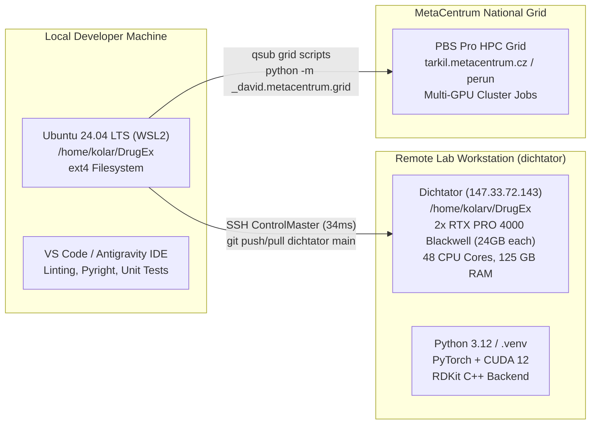
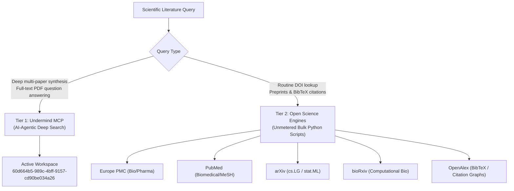

# 04: Environment Topology, Compute Infrastructure & Tooling

> **Author**: Antigravity (Gemini 3.8 Flash High)  
> **Prepared for**: Gemini 4.0 Argon & David Kolár  
> **Date**: 2026-10-29  
> **Scope**: Systems architecture, SSH multiplexing, multi-host synchronization, MetaCentrum grid, and MCP tooling.

---

## 1. Multi-Host Infrastructure Topology



### 1.1 Host Division of Responsibility
- **Local Laptop (WSL2)**:
  - Path: `/home/kolar/DrugEx` (Accessible from Windows at `C:\Ubuntu\home\kolar\DrugEx`).
  - Responsibilities: Code authoring, refactoring, documentation, strict static typing (`pyright`), fast linting (`ruff check`), and deterministic unit testing (`pytest _david/tests/`).
  - **Zero-Load Laptop Rule**: Never launch multi-epoch RL training or heavy multiprocessing jobs on the local laptop.
- **Remote Lab Node (`dichtator`)**:
  - Path: `/home/kolarv/DrugEx`.
  - Specs: **2x NVIDIA RTX PRO 4000 Blackwell GPUs** (24 GB VRAM each), 48 CPU cores, 125 GB RAM.
  - Virtualenv: `/home/kolarv/DrugEx/.venv/bin/python`.
  - Responsibilities: All GPU-accelerated RL training, massive conformer sampling, and multi-molecule calibrations.
- **National Grid (`MetaCentrum`)**:
  - Frontend: `tarkil.metacentrum.cz`, `perun.metacentrum.cz`.
  - Role: Long-running distributed sweeps submitted via PBS Pro batch queues.

---

## 2. SSH Architecture & Zero-Disruption VPN Protocol

Connecting to `dichtator` requires an active Cisco AnyConnect VPN tunnel to the University of Chemistry and Technology, Prague (VŠCHT).

### 2.1 The Zero-Disruption Rule
> [!CAUTION] Never Reset Active VPN Sessions
> Reconnecting or restarting Cisco VPN while a session is active corrupts the tunnel via Windows single-client lock contention (`CONNECTMGR_ERROR_ACQUIRE_CONNECT_CAPABILITY`).

Always probe the connection first:
```bash
ssh -o BatchMode=yes -o ConnectTimeout=15 dichtator "echo OK"
```
- If it returns `OK`, proceed directly.
- If it fails, prompt David to authenticate via the desktop shortcut (`C:\Users\kolar\Desktop\DrugEx.lnk`).

### 2.2 ControlMaster Multiplexing
All SSH operations reuse a persistent Unix domain socket located at `~/.ssh/sockets/%r@%h-%p`:
- Handshake latency drops from ~1,200ms to **~34ms per command**.
- Socket remains alive for 1 hour (`ControlPersist 1h`).
- If an SSH socket hangs, clean it with:
  ```bash
  rm -f ~/.ssh/sockets/*
  ```

---

## 3. Git Synchronization Rules

David actively inspects and edits code across both local WSL and remote `dichtator`. To prevent merge conflicts or data loss:

1. **Private Remote Protocol**:
   - Push to lab: `git push dichtator main`
   - Pull from lab: `git pull dichtator main`
   - **Never push to GitHub `origin` on thesis branches without authorization.**
2. **Inspect Dirty State Before Action**:
   - Always check `git status` on both hosts before initiating a pull or push.
   - Preserve David's scratchpad comments in [`_david/code/config.py`](file:///home/kolar/DrugEx/_david/code/config.py).
3. **Bulky Data Exclusion**:
   - Checkpoints (`.pt`, `.pkg`), raw dataset archives, and large multi-gigabyte `.sdf` files must never be committed to Git. They are tracked locally in `_david/output/`.

---

## 4. Academic Literature & MCP Tooling Suite

The project integrates a two-tiered academic research architecture to ensure literature decisions are backed by primary sources:



### 4.1 Tier 1: Undermind MCP
- **Authentication**: Connected under `kolarv@vscht.cz`.
- **Active Workspace**: `60d664b5-989c-4bff-9157-cd90be034a26` (*"Untitled Research Project"*).
- **Core Capabilities**:
  - `undermind:search_papers`: Rapid semantic search across titles and abstracts.
  - `undermind:launch_deep_search`: 3–5 minute autonomous AI agent literature sweep and re-ranking.
  - `undermind:read_pdfs`: Targeted full-text question answering against retrieved papers.

### 4.2 Tier 2: Open Science Literature Hub ([`scientific-literature`](file:///home/kolar/DrugEx/.agents/skills/scientific-literature/SKILL.md))
Located at `.agents/skills/scientific-literature/`, providing unmetered, keyless Python scripts for batch queries:
- `scripts/europepmc_api.py`: Full-text open-access biology/pharmacology papers.
- `scripts/pubmed_api.py`: MeSH-indexed clinical and chemical references.
- `scripts/search_arxiv.py`: Machine learning and reinforcement learning preprints.
- `scripts/search_by_dates.py` / `search_by_doi.py`: bioRxiv preprint tracking.
- `scripts/openalex_cli.py`: Automated BibTeX citations, impact factor, and citation graphs.

### 4.3 Methodological Decision Protocol ([`consult-literature`](file:///home/kolar/DrugEx/.agents/skills/consult-literature/SKILL.md))
Before altering any scientifically consequential hyperparameter, reward weighting, or conformer threshold:
1. State the baseline, proposed alternative, and intended benefit.
2. Search primary literature using `scientific-literature` or Undermind.
3. Record findings in `_david/code/conformer/results.md` distinguishing reported facts, code behavior, and hypotheses.
